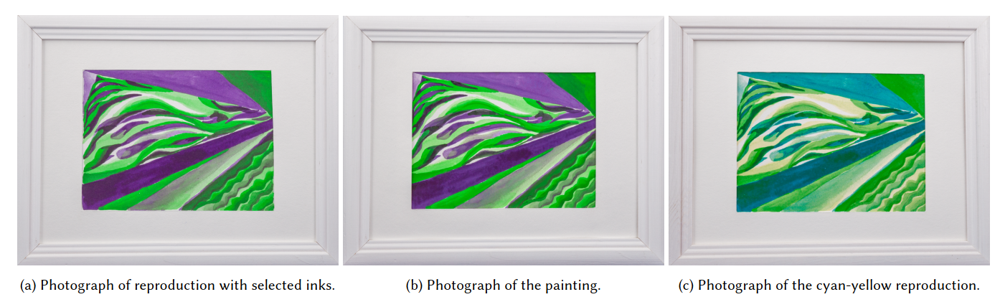

# Mixed Integer Ink Selection for Spectral Reproduction

**ACM Transactions on Graphics, 39(6), Article 255 · SIGGRAPH Asia 2020**

Navid Ansari · Omid Alizadeh-Mousavi · Hans-Peter Seidel · Vahid Babaei

[Paper](https://doi.org/10.1145/3414685.3417761) · [PDF](https://aidam.mpi-inf.mpg.de/data/pdfs/miisfsr.pdf) · [Supplementary material](https://aidam.mpi-inf.mpg.de/data/pdfs/miisfsr_SM.pdf) · [Download code and datasets](https://drive.google.com/file/d/1TwPk96DutU-MFO03uSR_5ThjqFBJIOHH/view?usp=sharing) · [Reproduction guide](docs/REPRODUCING.md)

**Choose a compact ink palette tailored to a painting's spectral appearance.**

This project explores how choosing the printing inks can improve the spectral reproduction of paintings. It combines **mixed-integer optimization** for ink selection with **neural spectral separation** for estimating the ink coverages needed to reproduce a target image.



*Duotone reproduction from Figure 1 of the paper. Left: reproduction with the selected inks. Center: the original painting. Right: reproduction with cyan and yellow.*

## Overview

The method formulates ink selection in **spectral absorbance space**, where a linear mixing model makes it possible to optimize the ink subset using mixed-integer linear programming. A small representative set of image spectra, called a coreset, reduces the size of the optimization problem.

After selection, neural models support spectral reproduction: a forward model predicts reflectance from ink area coverages, and an inverse model estimates coverages from target spectra. The inverse model can be adapted to an individual painting while keeping the forward model fixed.

This release contains a MATLAB selection example, PyTorch separation models and checkpoints, and spectral datasets. The selection example starts from precomputed coreset transmittances. The supplied neural example is configured for the **Flower painting and eight Epson inks**. Using a different selected ink set requires matching calibration data and models.

## Download and prepare the project

**The large data files are hosted on Google Drive because of their size.** Download and organize them before running neural separation or reproducing the data-dependent experiments.

| Location | Contents |
| --- | --- |
| This GitHub repository | Source code, pretrained checkpoints, small ink-selection inputs, and dataset previews. |
| [Google Drive archive](https://drive.google.com/file/d/1TwPk96DutU-MFO03uSR_5ThjqFBJIOHH/view?usp=sharing) | The complete original release, including neural training arrays, full painting spectra, paint measurements, and calibration channel patterns. |

First, clone this repository:

```bash
git clone https://github.com/AnsariNavid/mixed-integer-ink-selection.git
cd mixed-integer-ink-selection
```

Then prepare the data:

1. Download [`mixed-integer-ink-selection-code-and-dataset-master.zip`](https://drive.google.com/file/d/1TwPk96DutU-MFO03uSR_5ThjqFBJIOHH/view?usp=sharing).
2. Extract it into a separate folder, preserving its directory structure.
3. Copy the **contents** of the extracted `Dataset/` and `Spectral seperation neural networks/` folders into the matching folders in your GitHub checkout. Merge directories and skip existing files. Keep this repository's README and source files.

Do not put the entire extracted folder inside the checkout. For exact commands and expected file locations, see the [file preparation guide](docs/REPRODUCING.md#1-extract-and-organize-the-files).

The archive is approximately **6.31 GB**, with **6.46 GB** of uncompressed file contents. Allow space for the download, extracted data, and generated outputs. The small MATLAB ink-selection example can run with the files already in this repository.

## Project structure

| Directory | Contents |
| --- | --- |
| [`Ink_selection/`](Ink_selection/) | MATLAB optimization, the ink library, and precomputed painting coresets. |
| [`Spectral seperation neural networks/`](Spectral%20seperation%20neural%20networks/) | Forward and inverse neural models, adaptation, pretrained checkpoints, and coverage export. Add the training and painting arrays from Google Drive. |
| [`Dataset/`](Dataset/) | Dataset descriptions and preview images. Add paint spectra, spectral paintings, calibration arrays, and channel patterns from Google Drive. |

Keep the original directory names and spelling: the scripts use these paths.

## Run the examples

### Ink selection

Install **MATLAB**, **[YALMIP](https://yalmip.github.io/tutorial/installation/)**, and **[Gurobi with its MATLAB interface](https://docs.gurobi.com/projects/optimizer/en/current/reference/matlab/setup.html)** and a suitable license. From the project root in MATLAB:

```matlab
cd('Ink_selection')
absorbtance_optimization_demo
```

The default demo selects **at most eight inks** for the Cat coreset. On success, it returns `selected_inks` and `thickness` in the workspace and prints the objective and selected ink names. On Linux or macOS, first update its Windows-style input paths as described in the [MATLAB setup notes](docs/REPRODUCING.md#2-run-ink-selection).

### Neural spectral separation

Install **Python 3**, **NumPy**, **SciPy**, and **PyTorch**. The supplied inference script requires a working CUDA installation. From the project root:

```bash
cd "Spectral seperation neural networks"
python -c "from pathlib import Path; Path('painting_halftone').mkdir(exist_ok=True)"
python generate_halftone.py
```

This uses the supplied Flower checkpoints and writes eight-channel ink coverages to `painting_halftone/painting0.npy`, `painting1.npy`, and subsequent chunks.

For training, use this order from the same directory:

| Step | Script | Purpose |
| --- | --- | --- |
| 1 | `HalftoneToSpec.py` | Train the forward reflectance predictor. |
| 2 | `Forward+Backward.py` | Train the inverse model through the frozen forward model. |
| 3 | `Adaptive learning.py` | Adapt the inverse model to the Flower spectra. |
| 4 | `generate_halftone.py` | Generate ink coverages for the painting. |

Training writes to the existing checkpoint filenames. See the [reproduction guide](docs/REPRODUCING.md#3-run-neural-spectral-separation) for input files, checkpoint compatibility, changing the painting, and exporting channel TIFFs.

## Datasets

The full data release is provided in the linked archive. Spectra contain **31 wavelength samples from 400 to 700 nm**, at 10 nm intervals. Spectral images are stored as flattened pixel-by-wavelength arrays.

| Dataset | Contents |
| --- | --- |
| Watercolor paints | Reflectances of 423 paint patches. |
| Oil paints | Reflectances of 289 paint patches. |
| Printer calibration | 300 reference samples with reflectance and transmittance data. |
| Epson neural training | 33,945 paired reconstructed reflectance spectra and eight-channel ink coverages. |
| Spectral paintings | Full image spectra and image dimensions. |
| Ink-selection inputs | Library transmittances, ink names, and 200-spectrum painting coresets. |

The [data reference](docs/REPRODUCING.md#data-reference) lists exact filenames, MATLAB variable names, and array dimensions.

## Reproducing the paper

The supplied examples provide starting points for the computational workflow. For comparisons with a particular paper experiment, use the [reproduction notes](docs/REPRODUCING.md#5-reproduction-notes) to match the ink set, architecture, optimization settings, and evaluation procedure. Physical reproduction additionally requires the calibrated printing setup described in the paper.

## Citation

If you use this code or its datasets, please cite:

```bibtex
@article{Ansari2020InkSelection,
  author    = {Ansari, Navid and Alizadeh-Mousavi, Omid and
               Seidel, Hans-Peter and Babaei, Vahid},
  title     = {Mixed Integer Ink Selection for Spectral Reproduction},
  journal   = {ACM Transactions on Graphics},
  year      = {2020},
  volume    = {39},
  number    = {6},
  articleno = {255},
  numpages  = {16},
  doi       = {10.1145/3414685.3417761}
}
```
